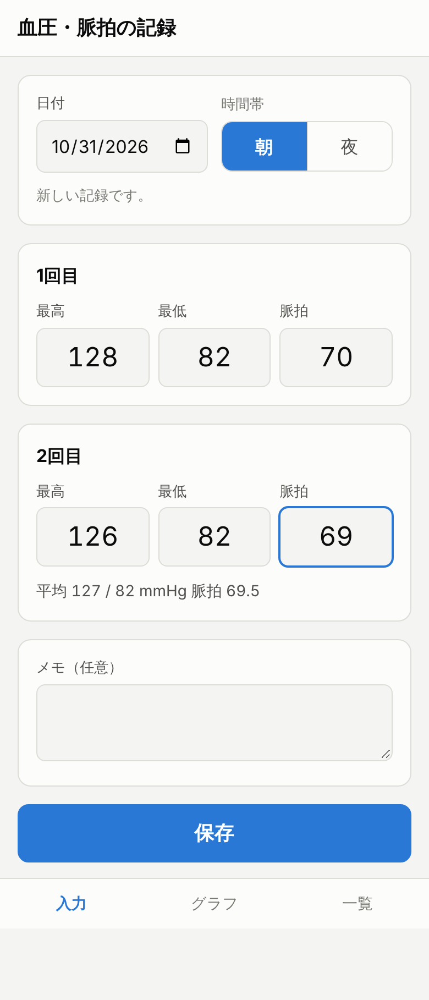
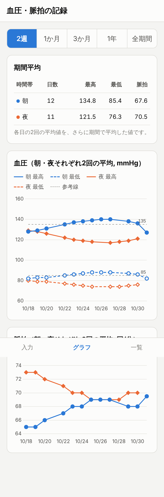

# 血圧・脈拍の記録アプリ（bp-tracker）

毎朝・毎夜それぞれ2回測る血圧と脈拍をスマホから入力して **Google シート** に保存し、
朝・夜それぞれの2回の平均値をグラフで確認する Web アプリです。
Google Apps Script（GAS）の Web アプリとして動くため、サーバーや API キーの用意は不要です。
スマホのホーム画面に追加すると、アプリのように起動できます。

| 入力 | グラフ |
|---|---|
|  |  |

## できること

- **入力**：日付・時間帯（朝／夜）・1回目と2回目の最高血圧／最低血圧／脈拍・メモ
  - 開いた時刻から日付と時間帯を自動で選びます（4〜14時台→朝、15時以降→夜、0〜3時台→前日の夜）
  - 数字を打つと次の欄へ自動で移動します。2回の平均をその場で表示します
  - 同じ日付・時間帯をもう一度保存すると上書きします（1回目だけ先に保存し、2回目を後から追加することも可能）
- **グラフ**：朝・夜それぞれの「2回の平均」を折れ線で表示（2週／1か月／3か月／1年／全期間）
  - 血圧：朝＝青・夜＝オレンジ、最高＝実線・最低＝点線、参考線（初期値 135/85、`Code.gs` の `CONFIG` で変更可）
  - 脈拍：別グラフ
  - 期間内の朝・夜それぞれの平均値（各日の2回平均をさらに期間で平均）を表で表示
- **一覧**：記録の一覧。行をタップすると編集・削除できます

## シートの形式

スプレッドシートに「記録」シートが自動で作られ、1行＝1日の朝または夜です。

| 日付 | 時間帯 | 1回目 最高 | 1回目 最低 | 1回目 脈拍 | 2回目 最高 | 2回目 最低 | 2回目 脈拍 | 平均 最高 | 平均 最低 | 平均 脈拍 | メモ | 更新日時 |
|---|---|---|---|---|---|---|---|---|---|---|---|---|

平均列は数式（`AVERAGE`）です。シート上で直接修正・追記しても、アプリ側は測定値から平均を計算し直すので表示は崩れません。

## セットアップ（初回のみ・10分程度）

1. **スプレッドシートを作成**：Google ドライブで新しいスプレッドシートを作ります（名前は例：「血圧記録」）。
   「ファイル → 設定 → タイムゾーン」が「(GMT+09:00) 東京」になっていることを確認します。
2. **Apps Script を開く**：スプレッドシートのメニュー「拡張機能 → Apps Script」。
3. **コードを貼り付け**
   - 最初からある `コード.gs`（`Code.gs`）の中身を全部消して、[`src/Code.gs`](src/Code.gs) の内容を貼り付けます。
   - 左の「ファイル」横の「＋」→「HTML」で、名前を **`Index`** にしてファイルを作り、[`src/Index.html`](src/Index.html) の内容を貼り付けます。
   - 保存（Ctrl+S / ⌘S）します。
4. **Web アプリとしてデプロイ**：右上「デプロイ → 新しいデプロイ」
   - 種類の選択（歯車）→「ウェブアプリ」
   - 次のユーザーとして実行：**自分**
   - アクセスできるユーザー：**自分のみ**
   - 「デプロイ」→ アクセスの承認を求められたら自分のアカウントで許可します
     （「Google がこのアプリを確認していません」と出た場合は「詳細」→「（プロジェクト名）に移動」）。
   - 表示された **ウェブアプリの URL**（`https://script.google.com/macros/s/…/exec`）をコピーします。
5. **スマホで開く**：URL をスマホに送り、スプレッドシートと同じ Google アカウントでログインしたブラウザで開きます。
   - iPhone（Safari）：共有ボタン →「ホーム画面に追加」
   - Android（Chrome）：︙メニュー →「ホーム画面に追加」

### コードを更新したとき

Apps Script エディタでコードを差し替えたあと、「デプロイ → デプロイを管理 → 鉛筆（編集）→ バージョン：新バージョン → デプロイ」。
URL は変わりません。

### clasp を使う場合（任意）

```bash
npm i -g @google/clasp
clasp login
clasp clone <スクリプトID> --rootDir src   # 手順2で作ったプロジェクトのID（プロジェクトの設定に表示）
clasp push
```

## 注意事項

- ブラウザで複数の Google アカウントに同時ログインしていると、Apps Script の Web アプリが読み込みエラーになることがあります。
  その場合はシークレットウィンドウや、スプレッドシートの所有アカウントだけでログインしたブラウザで開いてください。
- グラフ描画ライブラリ（Chart.js 4.4.1）は jsDelivr CDN から読み込みます。
- 入力値は誤入力防止のため、最高 50〜300、最低 20〜200、脈拍 20〜250 の整数のみ受け付けます（`Code.gs` の `LIMITS`）。
- 参考線は目安表示のための機能です。目標値は主治医の指示に合わせて `CONFIG` を変更してください。

## 開発

```bash
npm test   # Code.gs のロジックを Apps Script API のモック（test/mock-gas.js）上で検証
```

```
src/Code.gs          サーバー側（シートの読み書き、入力チェック）
src/Index.html       画面（入力・グラフ・一覧）
src/appsscript.json  マニフェスト（clasp 用。タイムゾーン Asia/Tokyo、Web アプリ設定）
test/                モックとテスト
```
